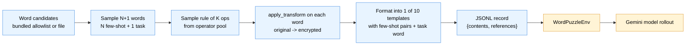

# Word Puzzle Dataset

Synthetic character-transformation puzzles for RL training and eval of Gemini
models. Each puzzle shows the model a few (`original`, `encrypted`) pairs
produced by a hidden rule, then asks it to invert (or apply) the rule on a new
word.

Four JSONL splits back this recipe, under `dataset/`. Some checkouts ship
them checked in; others ship only the generators, in which case build them
first with [`dataset/puzzle_dataset_gen.py`](dataset/puzzle_dataset_gen.py)
(base train/eval split) and
[`dataset/gen_withhold_eval.py`](dataset/gen_withhold_eval.py) (OOD splits) —
see [Regenerating the dataset](#regenerating-the-dataset).

| File | Rows | Used by | Purpose |
|---|---|---|---|
| `combined_training_word_transformation_v1.jsonl` | 394 | `word_puzzle/*`, `word_puzzle_simple/*` | RL training set |
| `combined_eval_word_transformation_v1.jsonl` | 137 | `word_puzzle/*`, `word_puzzle_simple/*` | Held-out eval set (in-distribution) |
| `combined_eval_word_transformation_withhold_v1.jsonl` | 116 | passed explicitly via `eval_data_path` | OOD eval: withhold operators the model never saw during training |
| `combined_eval_word_transformation_withhold_agent_v1.jsonl` | 122 | `word_puzzle_agent/*`, `run_agent_solver.py` | Agent-mode counterpart of the row above: same tier structure, but drops the `$\text{}$` answer trailer and adds a `retry_metadata` block |

The four splits were generated as 450 / 150 / 150 / 150 rows from an
unfiltered word source. Every row in which a slur, sexual term, profanity or
insult appeared anywhere in the prompt or answer was then removed, and such
words were dropped from each `retry_metadata.extra_word_pool`. The remaining
rows are otherwise unchanged. Removal was uneven across the withhold tiers
(A/B/C: 46/39/31 rows in the single-step split, 45/40/37 in the agent split),
because harder tiers show more words per prompt.

The agent twin is produced by `gen_withhold_eval.py --include-retry-metadata`
with `include_answer_format=False`. Its `retry_metadata` carries the
ground-truth `rule` plus an `extra_word_pool`, so `run_agent_solver.py` can
mint fresh worked (`original`, `encrypted`) pairs after a wrong submit under
`--submit-retries`. **It therefore contains the answer rule in plaintext** —
that is why the flag is off by default for the direct-answer JSONL.

The two "combined" files use the **`extended`** operator pool (shift /
mirror / rotate + 7 fixed structural transforms) and rules of depth 1-3.
Prompt lengths ~280-1050 chars (median ~670).

The **`withhold` eval file** tests generalization to a disjoint operator
pool -- 12 encoding/cipher transforms (base64, rot13, atbash, binary,
hex, ...) never seen during training. It is stratified across three
difficulty tiers, each row carrying a `tags` dict for per-slice
performance breakdown:

| Tier | Transforms | Few-shot | max_expanding_ops | Rows |
|---|---|---|---|---|
| A | 3-4 | 3 | unconstrained | 50 |
| B | 5-8 | 5 | 1 | 50 |
| C | 9-15 | 8 | 1 | 50 |

All three tiers draw rules from the whole `withhold` pool — **12 operators
as of the checked-in bytes**. The pool has since grown to 15, so
regenerating today does *not* reproduce these rows. Tiers
B and C apply a `max_expanding_ops=1` cap to prevent multiplicative
prompt-length blowup: 7 of those 12 ops are "expanding"
(`base64_encoding`, `hex_encoding`, `word_to_binary_string`,
`hex_and_reverse`, `base64_and_rot13`, `ascii_values_as_string`,
`duplicate_vowels`), meaning their output is longer than their input
(`duplicate_vowels` only when the word has vowels — `rhythm` is a
fixed point); composing multiple of them turns a 9-char word into 5-10 KB
of encoded string. Sampling at most 1 expanding op per rule kept all 150
generated prompts under 3 KB (measured max 2,519 bytes) while preserving up-to-one
expanding op per rule for op diversity. The cap is uniform in
`[0, max_expanding_ops]`, so about half the tier B/C rules end up with 0
expanding ops (pure length-preserving composition) and half with 1
(measured: tier B 24/26, tier C 28/22). Tier A is unconstrained and does
run 2-4 expanding ops per rule, but with only 3-4 ops total even the
worst case stays under ~2.5 KB — it is in fact the 2,519-byte maximum
above. See `gen_withhold_eval.py`
for the generator and `EXPANDING_OPERATORS` in `puzzle_dataset_gen.py`
for the operator classification.

Each row in the withhold file has a top-level `tags` key:

```json
{"tier": "B", "num_transformations": 6, "num_few_shot": 5,
 "operator_set": "withhold", "max_expanding_ops": 1,
 "reverse_task": false}
```

`parse_word_puzzle_item` passes `tags` through into `WordPuzzleEnv.task_data`,
and the eval pipeline dumps `task_data` verbatim into results JSONL, so
you can group by tag when analyzing results.

## Pipeline



Everything in blue is deterministic given a seed; the model call (yellow) is
the only stochastic step at eval time.

## Record schema

Every line of both JSONLs is a single JSON object:

```json
{
  "contents": [
    {
      "role": "user",
      "parts": [{"text": "You are a master codebreaker...\n\n...\n\n$\\text{your answer}$"}]
    }
  ],
  "references": {"reference": "thread"}
}
```

- `contents` follows the Gemini `generateContent` shape (one user turn).
- `references.reference` is the ground-truth answer (the original word for
  decrypt-direction puzzles, the encrypted word for encrypt-direction).
- Loaded by `WordPuzzleEnv` via `parse_word_puzzle_item` in `env.py`,
  which reshapes to `{"question", "reference"}` before the env consumes it.
- The env extracts the model's answer with the regex `\text{(.*?)}` (LaTeX
  `\text{}` -- see `extract_answer_fn` in `env.py`); the puzzle
  templates instruct the model to close with `$\text{your answer}$`.

Sample row from `combined_training_word_transformation_v1.jsonl` (truncated):

```
prompt : "Infer a function `f(x)` given the following examples.
          f('underdeveloped') = 'qjZanZarahklaZ'
          f('educates') = 'aZqYWpao'
          f('stryder') = 'opnuZan'
          Given `y = 'pdnaWZ'`, find `x` such that `f(x) = y`.
          First, define the function, then provide the answer.
          Put your final answer in the following format:
          $\text{your answer}$"
answer : "thread"
```

## Rule taxonomy

A rule is a list of `(operator_name, param)` tuples. Applied left-to-right by
`apply_transform` in `puzzle_dataset_gen.py`.

`OPERATOR_SETS` has eight pools. The three `v1` pools below are documented in
full; the property-matched `extended_v2` (14) / `withhold_v2` (9) and
`extended_v2_1_1` (26) / `withhold_v2_1_1` (20) splits back the v2 datasets.
Print any of them with:

```sh
PYTHONPATH=src uv run python -c '
from example_recipe.word_puzzle.dataset.puzzle_dataset_gen import OPERATOR_SETS
for k, v in OPERATOR_SETS.items(): print(f"{k:20} {len(v):2}  {sorted(v)}")'
```

### `basic` -- 3 parameterized character transforms

| Operator | Param | Example (`hello`) |
|---|---|---|
| `shift` | `shift: int` (1-51) | `hello` → `olssv` (Caesar cipher, wraps `a-zA-Z`) |
| `rotate` | `rotate: int` (1..len-1) | `hello` → `llohe` (cyclic left-rotate) |
| `mirror` | `copy_input: bool` | `hello` → `olleh` (reverse), or `helloolleh` if copied |

### `extended` = `basic` + 7 fixed (parameter-free) transforms

Used by the checked-in training + eval JSONLs.

| Operator | Example (`hello`) |
|---|---|
| `swap_adjacent_char_pairs` | `hello` → `ehllo` |
| `reverse_blocks_of_3` | `hello` → `lehol` |
| `weave_from_ends` | `hello` → `hoell` |
| `move_middle_to_front` | `hello` → `lhelo` |
| `move_middle_to_end` | `hello` → `helol` |
| `interleave_split_string` | `hello` → `hleol` |
| `pull_outer_to_middle` | `hello` → `eholl` |

### `withhold` -- 15 eval-only encoding/cipher transforms

> This pool was 12 before `vowel_cycle`, `consonant_cycle` and
> `keyboard_shift` were added. The checked-in `*_withhold_*_v1.jsonl` files
> predate that and use the original 12; 15 is what a fresh generation uses.

Reserved for OOD (out-of-distribution) generalization eval. Not used in the
shipped training set: `base64_encoding`, `hex_encoding`, `rot13_cipher`,
`word_to_binary_string`, `atbash_cipher`, `hex_and_reverse`,
`base64_and_rot13`, `ascii_values_as_string`, `shift_chars_by_position`,
`alternate_ascii_add_subtract`, `duplicate_vowels`, `reverse_vowel_order`,
`vowel_cycle`, `consonant_cycle`, `keyboard_shift`.

### `all` = `extended` ∪ `withhold` = 25 operators

### Invertibility (why puzzles are solvable)

Every rule must be **losslessly recoverable**: given the encrypted string and
the rule, the model can reconstruct the original character-by-character. This
is what makes the task well-posed — for the decrypt direction there is
exactly one correct answer, not many.

Concretely, the operators are **bijective** (one-to-one) on fixed-length
inputs, so composing them into a rule of any depth still yields a bijection:
applying the reverse chain to the encrypted string recovers the original
exactly. The bijectivity is guaranteed by construction:

- **Character-level ciphers** (`shift`, `rot13_cipher`, `atbash_cipher`,
  `shift_chars_by_position`, `alternate_ascii_add_subtract`) map each
  position to a new codepoint via a bijective function on the character
  alphabet.
- **Positional permutations** (`rotate`, `mirror`, `reverse_blocks_of_3`,
  `swap_adjacent_char_pairs`, `weave_from_ends`, `move_middle_to_front`,
  `move_middle_to_end`, `pull_outer_to_middle`, `reverse_vowel_order`) shuffle
  characters without dropping or duplicating any — pure permutations.
- **Encodings** (`base64_encoding`, `hex_encoding`, `word_to_binary_string`,
  `ascii_values_as_string`, `hex_and_reverse`, `base64_and_rot13`) are
  standard reversible encodings of the input bytes.
- **Multi-character rewrites** (`duplicate_vowels`) map each original
  character to a fixed length-1-or-2 code where the code fully determines
  the original.

Checked empirically over all 7,776 distinct 5-character strings on a 6-letter
alphabet: an operator is expected to produce 7,776 distinct outputs (zero
collisions), so the mapping is injective in practice as well as in theory.
`interleave_split_string` was historically lossy on odd-length inputs (1,296
distinct outputs); it was rewritten to append `s[len(s) // 2]` rather than an
already-copied character and now passes the same exhaustive check. See
`tests/unit/test_puzzle_dataset_gen.py::TestRoundTrip` for the
`apply_transform(original, rule) == encrypted` round-trip pinned on every
generated task.

**Self-inverse operators** (applying twice returns the original;
`f(f(x)) = x`): `mirror` (non-copy variant), `swap_adjacent_char_pairs`,
`reverse_blocks_of_3`, `rot13_cipher`, `atbash_cipher`, `reverse_vowel_order`.
These are convenient for encrypt-direction (`reverse_task=True`) puzzles
because the same operator serves as both encoder and decoder.

## Prompt templates

Ten hand-written "personas" for the same underlying task, sampled uniformly
per puzzle. Each template has two variants: decrypt-direction (given
encrypted, find original) and encrypt-direction (given original, find
encrypted). With `explain_encryption=True` (the checked-in default), the
prompt also asks the model to describe the rule before answering.

| ID | Persona |
|---|---|
| 1 | The Codebreaker |
| 2 | The Linguistic Analyst |
| 3 | The Direct Pattern Finder |
| 4 | The Software Engineer |
| 5 | The Game Show Host |
| 6 | The Historical Cryptographer |
| 7 | The AI Trainer (JSON-formatted examples) |
| 8 | The Xenolinguist |
| 9 | The Alchemist's Apprentice |
| 10 | The Minimalist Function |

## Regenerating the dataset

Everything in this recipe is deterministic given a seed. Two entry points:

### 1. Reusable util -- `puzzle_dataset_gen.py`

```python
import random
from example_recipe.word_puzzle import puzzle_dataset_gen as pdg

words = pdg.load_word_candidates(min_length=5)  # bundled word_allowlist.txt

task = pdg.generate_one_task(
    num_transformations=5,
    num_few_shot_examples=5,
    word_candidates=words,
    operators=pdg.EXTENDED_OPERATORS,
    rng=random.Random(42),
)
task.prompt              # the full prompt text
task.expected_answer     # ground truth
task.rule                # list of (op_name, param) tuples
task.template_id         # 1..10
task.few_shot_examples   # list of (original, encrypted) pairs
task.to_jsonl_record()   # {contents, references} wire shape
```

To batch-generate a JSONL:

```bash
uv run python -m example_recipe.word_puzzle.dataset.puzzle_dataset_gen \
    --output out.jsonl \
    --num-examples 225 \
    --num-transformations 2 \
    --num-few-shot-examples 4 \
    --operator-set extended \
    --seed 42
```

With `--flip-reverse-task` (default on), the output has both
decrypt-direction and encrypt-direction puzzles, so
`--num-examples 225` produces 450 rows (the size of
`combined_training_word_transformation_v1.jsonl` before filtering).

### 2. Generate + eval in one shot -- `run_generated_eval.py`

Generates puzzles on the fly into a temp JSONL and runs the eval plug-in
(`eval_config_entry.run_eval`) against a Gemini endpoint. No file to manage.

```bash
PYTHONPATH=src uv run python -m example_recipe.word_puzzle.dataset.run_generated_eval \
    num_tasks=50 \
    num_transformations=5 \
    num_few_shot_examples=5 \
    operator_set=extended \
    seed=42 \
    backend=gemini_endpoint \
    gemini_endpoint_model=gemini-3.5-flash \
    gemini_endpoint_env=prod \
    gemini_endpoint_project=<your-project> \
    eval_samples_per_task=1 \
    max_concurrent_samples=64
```

Pass `keep_temp=true` to retain the generated JSONL for inspection.

## Eval baselines

Baseline runs of `gemini-3.5-flash` (no fine-tuning) on the withhold OOD
eval set, all with `--seed 42` in dataset generation and concurrency 64.

> Historical measurements against the 150-row, 12-operator
> `combined_eval_word_transformation_withhold_v1.jsonl`, before it was
> filtered to 116 rows. They have not been re-run since, and a dataset
> regenerated today (15-op pool) is a different benchmark — don't compare
> new numbers against this table.

| Run | `thinking_level` | `max_generation_tokens` | Accuracy | `MAX_TOKENS` rate | Avg sample time |
|---|---|---|---|---|---|
| 1 | high | 32768 (default) | 26.7% | 87/150 (58%) | 122.7 s |
| 2 | medium | 32768 (default) | 29.3% | 84/150 (56%) | 124.0 s |
| 3 | high | 65536 | 36.0% | 22/150 (15%) | 185.0 s |
| **4** | **medium** | **65536** | **40.0%** | **14/150 (9%)** | **173.0 s** |
| 5 | low | 65536 | 30.7% | 0/150 (0%) | 82.3 s |
| 6 | minimal | 65536 | 22.0% | 0/150 (0%) | 47.6 s |

Takeaways:

- The 32K-token default cap is budget-starved for withhold puzzles at
  `thinking >= medium` (~57% `MAX_TOKENS` rate); bumping to 64K drops
  the rate to ~12% and lifts accuracy by 9-11 points. Thinking-low and
  thinking-minimal never hit the cap at 64K.
- Accuracy vs. thinking level follows an inverted-U at the 64K budget
  (minimal 22.0% -> low 30.7% -> medium 40.0% -> high 36.0%). Extra
  reasoning past medium hurts: high hits `MAX_TOKENS` 3x more often
  than medium and drifts on prompts that finish.
- Medium is the pareto-optimal point: best accuracy (40.0%) with
  reasonable latency (173 s/sample). Low (30.7%, 82 s) is the
  latency-first alternative; minimal (22.0%, 48 s) is the no-reasoning
  floor.
- Latency scales roughly linearly with reasoning depth (48 s -> 82 s
  -> 173 s -> 185 s).
- Best base-model baseline: 40% accuracy (medium, 64K tokens).

### Exact command (best baseline, run 4)

```bash
PYTHONPATH=src uv run python src/eval.py \
    config_name=word_puzzle/async \
    eval_data_path=src/example_recipe/word_puzzle/dataset/combined_eval_word_transformation_withhold_v1.jsonl \
    jsonl_output_path=/tmp/wp_eval_withhold_medium.jsonl
```

`src/eval.py` only accepts the launch-env args listed in the top-level
README (`config_name`, `target`, `vertex_*`, `eval_data_path`,
`jsonl_output_path`, `max_eval_items`). Backend, `thinking_level` and
`max_generation_tokens` are recipe fields — add a `CONFIGS` variant in
`single_step/configs.py` for a different operating point. All
four runs finish in 6-15 minutes wallclock.

Note: aggregate metrics only; the eval plug-in doesn't currently
break down accuracy by `tags.tier`. For per-tier analysis, either extend
a `MetricAggregator` (see `METRICS.md`) to slice on `task_data.tags` or split
the JSONL into three tier-specific files and run one eval each.

## Determinism guarantee

Same `seed` **and same operator pool** → byte-identical output. The pool is
part of the input: `withhold` has grown from 12 operators to 15 since the
checked-in `*_v1.jsonl` were generated, so a fresh run cannot reproduce
them even at `--seed 42`. Pinned by `tests/unit/test_puzzle_dataset_gen.py`:

- `TestDeterminism` -- covers `generate_one_task`, `generate_dataset`, JSONL
  bytes, every entry in `OPERATOR_SETS` (8 pools), and `flip_reverse_task`.
- `TestCrossProcessReproducibility` -- fresh subprocess with same seed
  produces identical output (catches hidden global-state randomness).
- `TestSeedSensitivity` -- different seeds diverge; `rng=None` is
  genuinely nondeterministic (guards against a hidden default seed).

Run with:

```bash
uv run python -m pytest tests/unit/test_puzzle_dataset_gen.py -v
```

## Dependencies

- **`dataset/word_allowlist.txt`**: the default word source, bundled with the
  recipe. It holds 127,573 filtered common English words (lowercase ASCII, at
  least 4 letters). To use your own list, pass `--word-list <path>` (one word
  per line). A list you supply is not filtered.
- Nothing else. No `google-genai`, no `google-cloud-storage`, no network I/O
  during generation.
